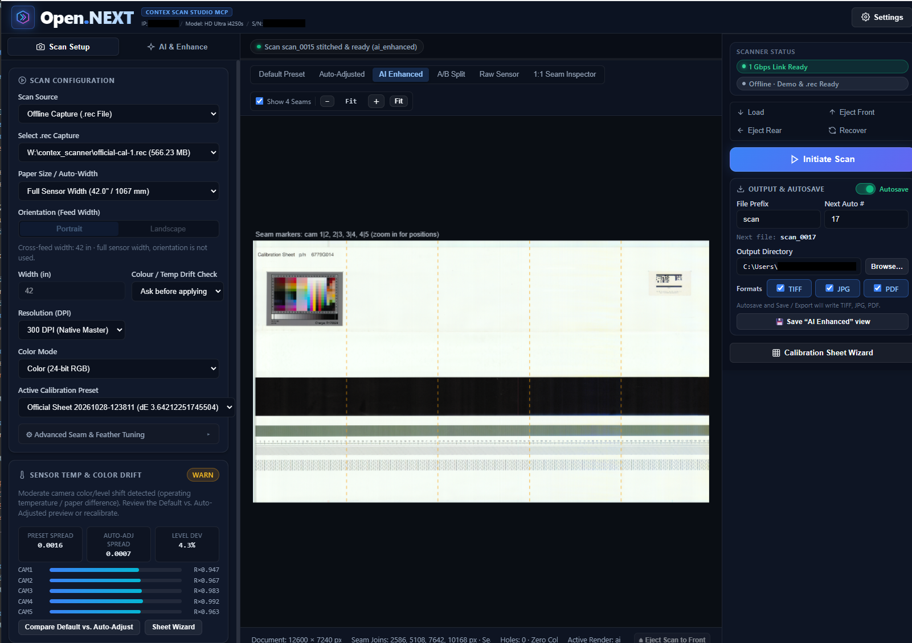
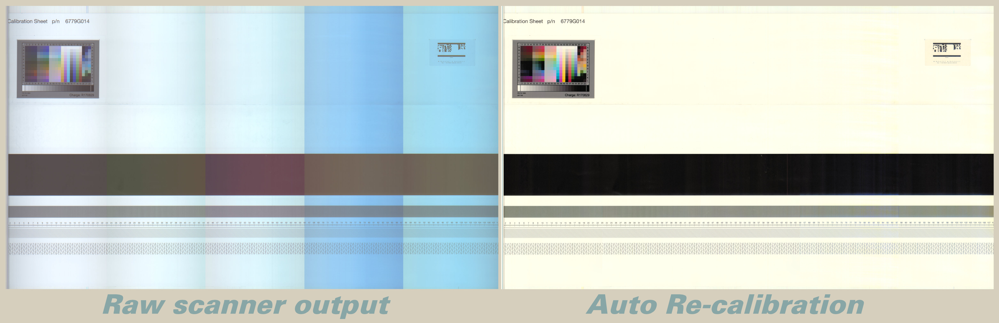
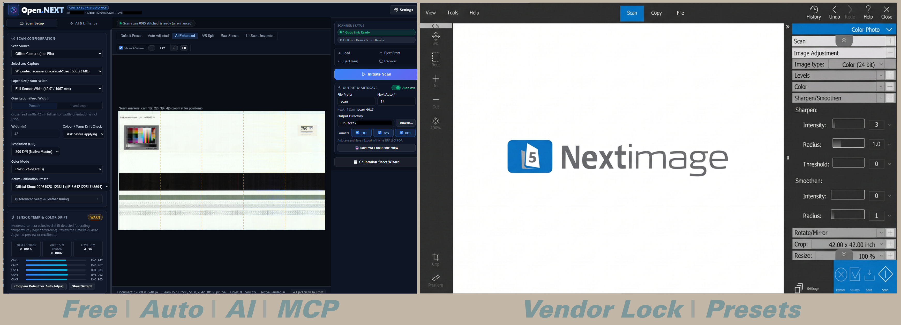
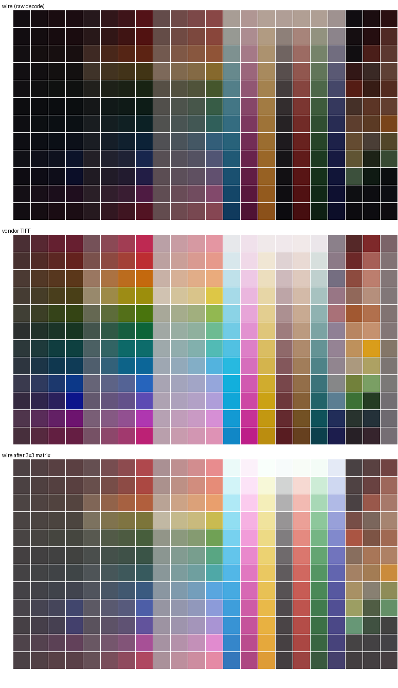

# Contex HD Ultra Series — Open Scanner Studio, Driver & MCP Server

Modern cross-platform scanner application, Model Context Protocol (MCP) server, and SCSI-over-TCP/UDP driver for **Contex HD Ultra series** large-format sheetfed scanners — built to replace Contex's Windows `.NET` **WIDEsystem** and **Nextimage** applications on **Linux (Ubuntu)** and **Windows** (with a clean path to standalone desktop packaging).

**License:** GNU GPL-3.0 — see [LICENSE](LICENSE).



---

## Hardware Baseline & Model Compatibility

* **Primary Reference Unit**: Developed and verified on a physical **Contex HD Ultra i4250s** with the **HD color** and **42-inch (5-camera)** scanning modules activated.
* **Series Compatibility**: The driver dynamically interrogates the scanner's SCSI Vital Product Data (VPD) and capability inquiry pages (`0xC0`–`0xC8`) to automatically query active camera count, optical sensor width, camera physical bed positions, and supported resolution tables. Consequently, the architecture is designed to support or easily adapt to other scanners across the **Contex HD Ultra series** (such as 36", 42", and 44" models, i3650, i4250, i4290, and related wide-format sheetfed units) with minor model-specific geometry or parameter adjustments.
* **LLM & Agent Ready**: Ships with a native Model Context Protocol (MCP) server allowing AI agents (Claude, Cursor, Antigravity, custom orchestrators) to trigger scans, inspect paper status, adjust color profiles, and run post-processing workflows autonomously.

---

## Architecture: Host Software Processing vs. Proprietary Hardware DSP

This application is an **open-source, host software-based solution** designed to replace the proprietary Contex closed ecosystem (WIDEsystem and Nextimage). Understanding this architectural distinction is key:

### 1. Software-Based Pipeline vs. Scanner Hardware
* **Proprietary Contex System**: In the OEM workflow, scanner firmware and internal DSP/ASIC hardware perform real-time line-by-line flat-fielding, gain normalization, and camera stitching as paper passes over the glass, or rely on proprietary Windows kernel-mode drivers and closed-source DLLs.
* **Open.NEXT Host Solution**: This application treats the scanner as a pure raw sensor. It interrogates the existing physical camera states over standard Ethernet, streams uncalibrated, unstitched 16-bit raw sensor data, and executes the entire analysis, normalization, colorimetry, and 5-camera geometric stitching **entirely in software on the host computer**.
* **Safety First**: All calibration profiles and drift adjustments are computed and stored as software references on the host PC (`~/.config/contex/<serial>/presets/`). The scanner's internal non-volatile EEPROM/flash is strictly guarded against writes (`WRITE BUFFER 0xA0` is unconditionally blocked in [`ctx/proto/cdb.py`](ctx/proto/cdb.py)), eliminating any risk of bricking the hardware.

### 2. Calibration Sheet Requirements & Developer Extensibility
* **Default Reference**: Out of the box, the built-in calibration wizard is modeled around the official **Contex Calibration Sheet** (`p/n 6779G014`, Charge `R170829`). It requires:
  1. **Black & White Optical Bands**: Used to calibrate live optical black pedestals ($B_i$) and per-column white-level flat-field profiles ($W_i$) across all 5 cameras.
  2. **264-Patch ANSI IT8.7/2 Target**: Used to derive the $3\times 3$ colorimetric matrix and gamma curve in CIE Lab / sRGB space ($\Delta E^*_{ab} = 2.30$ median).
* **Extensible for Any Target**: Because the calibration pipeline is 100% open Python ([`ctx/calibration.py`](ctx/calibration.py)), developers are not locked to Contex sheets. The target grid detection, coordinates, and reference color tables can be readily refactored to accommodate **any third-party or custom calibration sheet** (e.g., standard Kodak/Wolf Faust IT8 targets, X-Rite ColorCheckers, or custom architectural gray step charts).

### 3. Processing Performance: CUDA & Multi-Threading vs. Hardware Speed
* **Host Optimization**: The processing pipeline includes high-performance multi-threaded CPU routines (NumPy/OpenMP) and optional **NVIDIA CUDA GPU acceleration** (via CuPy for 10–12× faster color transforms).
* **Speed Trade-off**: Software-based host processing **does not match the instantaneous throughput of dedicated scanner ASIC/FPGA hardware line pre-calibration and stitching**, which operates at line-clock speed during paper travel. A 42" 300 DPI sheet takes ~10–25 seconds of post-scan host computation depending on CPU/GPU power and drift analysis settings.
* **The Software Advantage**: In exchange for this brief post-scan processing time, you gain complete freedom from vendor lock-in, pristine 16-bit unadulterated raw captures, non-destructive reprocessing, operating-temperature drift correction, and deep integration with modern AI post-processing models.

### 4. Photocraft as an External Generative AI Processing Hook
* **Neural Post-Processing**: In addition to local algorithmic filters (seam micro-inpainting, bilateral shadow denoising, paper clean-up), the engine features a dedicated processing hook for **Photocraft** ([`ctx/ai.py`](ctx/ai.py)).
* **How It Works**: When configured via the WebUI **AI & Enhance** tab, REST API (`/api/scans/{id}/enhance`), or MCP tool (`scanner_ai_enhance`), the host pipeline sends a high-fidelity image payload to an external Photocraft HTTP webhook along with prompt instructions.
* **Seamless Reintegration**: Photocraft performs deep generative restoration (e.g. damaged blueprint reconstruction, severe crease removal, background texturization) and streams the restored image back to the host, where it is converted back to 16-bit, registered as `<scan_id>_AI.<ext>`, and displayed in the viewer with side-by-side or A/B split comparisons.
* **Auto AI Enhance**: You can enable the **Auto AI Enhance** toggle to have Photocraft run automatically after every scan, fully automating end-to-end scanning, stitching, and neural AI restoration.



---

## Key Capabilities & End-to-End Scan Workflow

The application implements the full 5-camera hardware and imaging pipeline established in [`DESIGN.md`](DESIGN.md) and [`SPECS.md`](SPECS.md):

```
Initiate Scan ──► Collect 5-Cam UDP Stream ──► Reorder Cam 1..5 & Apply Color Calibration
                                                          │
   ┌──────────────────────────────────────────────────────┘
   ▼
Colour / Temp Drift Check — Ask  |  Auto-correct  |  Off (bulk: skips the analysis and the second stitch)
   │
   ├─► [Ask + WARN/DRIFT] ──► Drift Comparison Modal (one shared zoom/pan for both previews)
   │                            ├─► Ignore (Keep Default Preset)
   │                            ├─► Apply Auto-Adjust (or Save/Update Preset)
   │                            └─► Calibrate with the Contex Calibration Sheet (6779G014)
   │
   ▼
Stitch 5 Cameras (12,600 px / 42.000" @ 300 DPI) — three render variants:
   ├─► Default Preset   (plain stored-preset render)
   ├─► Auto-Adjusted    (margin self-calibrated; needs the drift check on)
   └─► AI Enhanced      (optional local/Photocraft post-processing, or Auto AI Enhance)
   │
   ▼
Review in the viewer ──► Save current view (TIFF / JPG / PDF) ──► Autosave writes the standard render
```

1. **Hardware Arming & High-Speed Stream Collection (`ctx/engine.py`)**:
   - Gigabit Ethernet preflight check (warns if link `< 1000 Mbps`, allocates a `64 MB` UDP receive buffer).
   - Automatic paper recovery (`Unload -> Load` when the scanner is left in `0x24 SCANNING`), plus the rail's feed controls **Load**, **Eject Front (`0xFFFFFE`)**, **Eject Rear (`0xFFFFFF`)** and **Recover** (an `Unload -> Load` cycle); `unload` is also exposed on the REST/MCP paper endpoints.
   - Executes the 32-command OEM arming sequence over `TCP 58170` and collects the 16-bit 5-camera stream over `UDP 58170` with credit pumping (`type 5`), pre-roll draining, and ACK-per-received record (`type 3`).
   - **Hard Flash Safety Guard**: `WRITE BUFFER 0xA0` (RAM → Flash commit) and programming modes are blocked unconditionally (`ctx/proto/cdb.py`).

2. **Camera-First Reordering & Multi-Preset Calibration (`ctx/calibration.py`)**:
   - Detects the five 23-px zero bands (`490 + 2728*k`) and masked ramps in the `13,640 px` (`81,840 B/row`) circular readout (`[cam5R][gap][cam1][gap][cam2][gap][cam3][gap][cam4][gap][cam5L]`) and reassembles `cam1..cam5` in physical bed order *before* flat-fielding or stitching.
   - Subtracts live per-scan optical black pedestals $B_i(\text{ch})$ measured from the masked dark ramp columns preceding each camera piece.
   - Manages multiple named presets (`~/.config/contex/<serial>/presets/`) with automatic `.bak` backups and one-click rollback:
     - **`default-it8`**: Official Contex IT8 + Flat-Field ($\gamma = 0.95$, $3\times 3$ matrix + offset, $\Delta E^*_{ab} = 2.30$ median).
     - **`architectural-neutral`**: 3D Architectural & CAD Bond (neutral white point $K = 41,000$).
     - **`artwork-photo`**: Fine Art & Large Photo.

3. **Operating-Temperature Color Drift Check & A/B Comparison (`ctx/calibration.py`, `ctx/web/`)**:
   - Evaluates camera-to-camera RGB chromaticity spread and white-level deviation across `cam1..cam5` (`OK`, `WARN`, `DRIFT`, or `INSUFFICIENT_WHITE` for full-bleed dark artwork).
   - Renders both **Default Preset** and **Auto-Adjusted (Margin Self-Calibrated)** previews so the user can inspect them side-by-side or with an interactive A/B split-slider before choosing to:
     - **Ignore (Keep Default Preset)**
     - **Apply Auto-Adjust** (with one-click promotion to update the active preset or save as a new named preset)
     - **Launch the Official Contex Calibration Sheet Wizard** (`p/n 6779G014`, Charge `R170829` — supports both **White Flat-Field** and **Full 264-Patch IT8.7/2** fitting). The IT8 grid **auto-aligns** by default: it sweeps the 22×12 sampling window and keeps the offset with the lowest ΔE76 (a hand-placed sheet typically lands 2–10 mm off), reports the chosen offset in 300-dpi pixels, refuses to apply a fit worse than mean ΔE76 **8.0**, and states which reference table was used (`R170829.it8`, or a warning when only the approximate `ctx/data/colour-patches.csv` fallback exists).
   - **Colour / Temp Drift Check** selector in **Scan Setup**: `Ask before applying`, `Auto-correct silently`, or `Off — bulk, fastest`. Setting it to `Off` skips both the drift analysis and the auto-adjusted second stitch (measured **23.6 s + 5.8 s per 42" / 300 dpi sheet**), so a batch never stops at a dialog.
   - Both previews in the drift dialog share one zoom/pan state (drag to pan, scroll to zoom, double-click to fit), so the same detail of A and B can be compared up to 1200 %.

4. **Seamless 5-Camera Stitching, Generative AI Post-Processing & Export (`ctx/pipeline.py`, `ctx/ai.py`)**:
   - Stitches `cam1..cam5` into a `12,600 px` (`42.000 in` @ 300 DPI) composite with `0` zero columns across the 4 seams (composite `x = 2586, 5108, 7642, 10168`; the raw camera module boundaries are `2,658 / 5,320 / 7,982 / 10,644`).
   - **Built-in Restoration & External AI / Photocraft Bridge (`ctx/ai.py`)**:
     - **4-Seam Micro-Inpainting**: Smooths sub-millimeter gradients across the 4 optical joins while preserving crossing architectural linework.
     - **3D Architectural Background Cleanup**: Soft-knee background paper equalization.
     - **Camera 4/5 Shadow & Chroma Denoising**: Edge-preserving bilateral chroma filter targeting shadow noise from Camera 4/5's 2.6× red gain boost.
     - **Edge-Aware Detail Sharpening**: Luminance unsharp mask for fine CAD/architectural text and linework.
     - **External Photocraft / MCP Webhook**: Connects to external generative AI restoration endpoints.
   - **Autosave & Multi-Format Export**: Exports in **Color** or **Grayscale** to **TIFF** (8-bit LZW or 16-bit), **JPG**, and **PDF** (with exact `300 DPI` physical dimensions). JPEG compression is selected from presets in **Settings**; the current JPEG quality applies to both autosave and manual export.
   - **Save the view you are looking at**: the button reads *Save “Default Preset” / “Auto-Adjusted” / “AI Enhanced” view* and writes exactly that render. On A/B Split, Raw Sensor or 1:1 Seam Inspector it is disabled — those are inspection views, not single images.
   - **One number per scan, one file per variant**: `CU-Kee_0087.tiff` (Default Preset), `CU-Kee_0087_Auto.tiff`, `CU-Kee_0087_AI.tiff`. The number is reserved for all three variants when the scan is created; saving the same view twice moves the whole group to the next number, so nothing is overwritten.
   - **Autosave is the bulk/failsafe path**: it writes the job's **standard calibrated render** (stored preset, or the accepted auto-adjusted one) and never an AI render on its own, because post-processing can always be redone later. The exception is **Auto AI Enhance**, which also writes `<number>_AI`. Each render is written once, so a later AI run cannot duplicate the standard file.
   - **Auto AI Enhance**: a toggle at the top of the **AI & Enhance** tab that runs that tab's current chain automatically as soon as a scan is ready (persisted as the `auto_ai_enhance` setting).
   - **Right-rail action column**: scanner status (link + media), feed controls (**Load / Eject Front / Eject Rear / Recover**), **Initiate Scan**, the **Output & Autosave** panel (autosave, file prefix, next auto number, formats, output directory with **Browse…**, save button) and the **Calibration Sheet Wizard**.
   - **Debug Mode Toggle**: When enabled in Settings, automatically saves `<scan_id>.rec`, `<scan_id>.jsonl`, 1:1 seam crops, and `<scan_id>-diagnostics.json` in `scans_output/debug/`.


---

## Quick Start (Ubuntu / Linux / Windows)

### 1. Install Dependencies

```bash
python3 -m pip install -r requirements.txt
```

> `websockets` is required for the `/ws/events` channel. Without it uvicorn
> rejects the WebSocket upgrade and the WebUI loses live scan progress and
> automatic loading of completed scans (it retries the socket in a loop).

#### Optional: NVIDIA CUDA acceleration

The IT8 colour transform runs on an NVIDIA GPU when CuPy and a working driver
are present, and falls back to the multithreaded CPU path otherwise. No
configuration is required; `python -m ctx app` logs which backend it picked.

```bash
# CUDA 12.x build; matches driver >= 525 with the CUDA 12 runtime installed.
python3 -m pip install cupy-cuda12x
```

- Verified on Ubuntu 24.04 with an RTX 4080 SUPER (driver 580) and CuPy 14.2:
  ~10-12x faster than the CPU transform, end-to-end scans ~1.6x.
- The GPU path matches the CPU output to within 1 LSB (float rounding only).
- The document is streamed through VRAM in row bands so peak usage stays near
  `CTX_CUDA_VRAM_BUDGET_GIB` (default `2.0`), not the full sheet. Raise it on a
  dedicated card, lower it if the desktop shares the GPU.
- The first GPU scan of a process pays ~1 s of one-off kernel compilation.

### 2. Launch the Contex Studio WebUI

```bash
# Launch with your scanner's IP address (default is 0.0.0.0 placeholder)
python3 -m ctx app --bind 127.0.0.1 --http-port 8080 --ip <scanner_ip>
```

> [!TIP]
> **Scanner IP Address Configuration & Auto-Detection:**
> The repository defaults to `0.0.0.0` as an unconfigured placeholder. You can set your scanner's actual LAN IP in any of three ways:
> 1. **Auto-Discovery**: Run `python3 -m ctx discover` on your local network. It broadcasts a probe (`UDP 58169`) and reports all online Contex scanners, their assigned IP addresses, models, and serial numbers.
> 2. **WebUI Settings**: Open the WebUI, click **Settings** (top-right gear), enter your scanner's IP in **Scanner IP Address**, and click **Save Settings**.
> 3. **CLI Argument**: Pass `--ip <your_scanner_ip>` when launching `ctx app`, `ctx scan`, or `ctx info`.

Open **`http://127.0.0.1:8080`** in your browser. The window has three columns:

| Column | Contents |
|---|---|
| **Left** | **Scan Setup** (source / `.rec` capture, paper size, orientation, drift check, DPI, colour mode, preset, seam blending) and **AI & Enhance** (auto AI enhance, seam harmonisation, micro-inpaint, denoise, sharpen, Photocraft webhook) |
| **Centre** | Engine status strip with the animated activity beam, the view tabs, and the deep-zoom canvas (wheel = zoom, drag = pan, `1`–`6` = view, `+`/`-`/`0` = zoom) |
| **Right** | Scanner status, feed controls, **Initiate Scan**, **Output & Autosave**, **Calibration Sheet Wizard** |

View tabs, in order: **Default Preset**, **Auto-Adjusted**, **AI Enhanced**, **A/B Split**, **Raw Sensor**, **1:1 Seam Inspector**. The first three are savable renders and grey out when the scan cannot produce them (AI before post-processing, Auto-Adjusted while the drift check is off).

- **No scanner connected?** Pick **Demo: 3D Architectural + IT8**, **Demo: Full-Bleed Artwork**, or any local `.rec` capture as the source in **Scan Setup**, then click **Initiate Scan** to exercise the whole 5-camera 16-bit calibration, drift modal, calibration sheet wizard, AI post-processing and TIFF/JPG/PDF export pipeline offline.
- **Live scanner connected?** Select **Live hardware**, load media with **Load**, then click **Initiate Scan**.

#### Bulk scanning (e.g. 30 sheets unattended)

1. **Scan Setup → Colour / Temp Drift Check → Off — bulk, fastest** — skips the drift analysis and the second stitch (~29 s saved per 42" sheet).
2. **Output & Autosave** — turn **Autosave** on, set **File Prefix** and **Next Auto #**, choose formats and the output directory; set **Post-scan paper handling** in Settings if the feeder should eject each sheet.
3. Click **Initiate Scan** once per sheet (or press the panel **Scan** key with panel keys enabled). Every sheet lands as `<prefix>_NNNN.<ext>` with no dialog stopping the run.

Memory stays flat by design: only the **two newest scans** keep their raster and stitched buffers (so re-export and sheet calibration still work); older jobs release those buffers and keep metadata, previews and exported files. Re-exporting an older scan returns a clear `buffers were released` error.

### 3. Launch the MCP Server (for AI Agents, DSH & Photocraft)

An external AI agent or agent harness (such as **DSH**, Antigravity, Claude Desktop, Cursor, Photocraft, or a custom orchestrator) can control the scanner and post-processing pipeline directly via **3 interfaces**:

#### Interface A: Model Context Protocol (`stdio` or `sse`) — [`ctx/mcp_server.py`](ctx/mcp_server.py)

```bash
# Standard stdio transport (for local agent harnesses):
python3 -m ctx mcp

# SSE HTTP transport (for remote/networked agent harnesses):
python3 -m ctx mcp --transport sse
```

Example `mcpServers` configuration for your agent harness:

```json
{
  "mcpServers": {
    "contex-scanner": {
      "command": "python3",
      "args": ["-m", "ctx", "mcp"],
      "cwd": "/path/to/contex_scanner"
    }
  }
}
```

**Exposed MCP tools:**
- `scanner_status()` — hardware link, Gigabit preflight, media status (`0x30 READY` / `0x24 SCANNING`), presets, and recent scans
- `scanner_paper_control(action="load" | "unload" | "eject_front" | "eject_back" | "recover")`
- `scanner_cancel_scan()` — ask the active scan to stop at the next safe point
- `scanner_initiate_scan(source_mode, rec_path, paper_size, orientation, width_inches, dpi, color_mode, preset_id, simulate_thermal_drift, seam_color_blend, seam_blend_width_px, seam_blend_strength, seam_feather_mode)`
- `scanner_resolve_drift(scan_id, choice="preset" | "auto_adjust", promote_to_preset, save_as_new_preset_name)`
- `scanner_calibrate_official_sheet(scan_id, sheet_mode="white_flatfield" | "it8_full", save_as_preset_id, save_as_preset_name, auto_align=True)`
- `scanner_ai_enhance(scan_id, blend_seam_colors, seam_blend_width_px, seam_blend_strength, seam_feather_mode, heal_seams, seam_radius_px, clean_background, denoise_shadows, sharpen_detail, external_provider, external_url, external_prompt)`
- `scanner_export(scan_id, formats=["tiff", "jpg", "pdf"], color_mode="color" | "grayscale", tiff_16bit, debug_mode, render_mode="preset" | "auto_adjust" | "ai_enhanced")`
- **MCP Resource**: `contex://status` (live JSON snapshot of hardware, settings, and presets)

#### Interface B: HTTP REST + WebSocket API (with OpenAPI Schema) — [`ctx/server.py`](ctx/server.py)

When `python3 -m ctx app --bind 0.0.0.0 --http-port 8080` is running, external harnesses can drive the app over HTTP while **simultaneously updating any open WebUI browser window in real time via WebSockets (`/ws/events`)**:

- **OpenAPI 3.1 Schema (for automatic agent tool ingestion)**: `GET http://127.0.0.1:8080/openapi.json` (interactive docs at `/docs`)
- **REST Endpoints**:
  - `GET  /api/status` — Hardware, Gigabit preflight, settings, presets, and recent scans
  - `POST /api/discover` — UDP 58169 broadcast discovery
  - `POST /api/paper/{load|unload|eject_front|eject_back|recover}` — Feeder control
  - `GET  /api/settings` & `PUT /api/settings` — Read/update drift policy (`prompt` | `auto_adjust` | `disabled`), autosave, **auto AI enhance**, output directory, filename prefix, next sequence number, export formats, JPEG quality (`1..100`), debug mode, post-scan paper handling, etc.
  - `GET  /api/fs/dirs?path=…` — List sub-directories (directories only) for the WebUI output-folder browser
  - `GET  /api/presets` & `POST /api/presets/{preset_id}/rollback` — Inspect or roll back calibration presets
  - `POST /api/scan/start` — Run scan & return `scan_id`, `drift_report`, and preview URLs
  - `POST /api/scans/{scan_id}/drift-decision` — Choose `"preset"` vs. `"auto_adjust"` and optionally save/promote preset
  - `POST /api/scans/{scan_id}/calibrate-sheet` — Fit Official Contex Calibration Sheet (`p/n 6779G014`, `R170829`)
  - `POST /api/scans/{scan_id}/enhance` — Run local or external AI post-processing
  - `POST /api/scans/{scan_id}/export` — Export `TIFF`, `JPG`, `PDF` in `"color"` or `"grayscale"`, with optional `render_mode` (`"preset"` | `"auto_adjust"` | `"ai_enhanced"`) selecting which render is written; the variant suffix (`_Auto`, `_AI`) shares the scan's number
  - `GET  /api/status` also reports per-job `available_renders` (`preset` / `auto_adjust` / `ai_enhanced`) and `buffers_released`
- **Multimodal / Vision Agent Inspection Endpoints**:
  - `GET /api/scans/{scan_id}/preview/{raw|preset|auto_adjust|ai_enhanced}` — Serves rendered PNG previews (also cached on disk at `scans_output/.previews/<scan_id>/`) so a vision-capable agent can visually compare **Default Preset** vs. **Auto-Adjusted** before calling `/drift-decision`.
  - `GET /api/scans/{scan_id}/seam/{0..3}` — Serves 1:1 pixel crops across the 4 camera joins (composite `x = 2586, 5108, 7642, 10168`).

#### Interface C: Direct In-Process Python SDK

Python-based agent harnesses can import [`ScanWorkspaceManager`](ctx/server.py) directly:

```python
from ctx.server import ScanWorkspaceManager

ws = ScanWorkspaceManager()
job = ws.execute_scan_workflow(source_mode="live", width_inches=42.0, color_mode="color")
if job.drift_report["verdict"] in ("WARN", "DRIFT"):
    job = ws.resolve_drift_decision(job.scan_id, choice="auto_adjust", promote_to_preset=True)
```

---

## Low-Level CLI Reference (`python -m ctx`)

In addition to `ctx app` and `ctx mcp`, the command-line tool provides direct protocol utilities:

```bash
python3 -m ctx discover                     # UDP 58169 broadcast discovery
python3 -m ctx info --ip 0.0.0.0        # Read-only INQUIRY + VPD capability pages
python3 -m ctx plan --dpi 300 --width-in 42 # Print the command sequence without I/O
python3 -m ctx scan --out scan-name         # Run a low-level scan to .bin + .jsonl
python3 -m ctx param --buffer 0xbf          # READ BUFFER parameter block dump
python3 -m ctx pcap capture.pcapng          # Offline capture reassembly
```

---

## Reverse-Engineering Summary & Protocol Architecture

| Area | State |
|---|---|
| Discovery (`UDP 58169`) | Solved |
| Command channel (`TCP 58170`, 28-byte `SCSISENSE` replies) | Solved |
| Image channel (`UDP 58171` → host `58170`) | Solved |
| IP fragment reassembly (`1,480 + 1,480` B) | Solved |
| 16-bit 5-camera framing (`81,840 B/row` = `13,640 px × 3 ch × u16 LE`) | Solved |
| Circular readout & 5-camera bed order (`cam5 = piece5 + piece0`) | Solved (`0` zero cols) |
| Two-point per-column flat-field (`W_i`, `B_i`) + IT8 (`R170829`) | Solved ($\Delta E^*_{ab} = 2.30$ median) |
| Operating-temperature drift check & margin self-calibration | Solved |

### The Finding That Mattered Most

Image records are **2,960-byte UDP datagrams fragmented into 1,480 + 1,480**. Reading only the first fragment silently discards 49.5 % of every record. Reassembly by `(src, dst, IP id)`, ordered by fragment offset, is mandatory.

The 16-byte little-endian application header is:

| Offset | Type | Meaning |
|---|---|---|
| 0 | `u16` | Sync `0xFFFF` |
| 2 | `u32` | Sequence |
| 6 | `u16` | Type (`7`/`9` = start, `1` = data, `2` = final, `3` = ack, `4` = nak, `5` = credit) |
| 8 | `u16` | `dlen` — valid bytes in this record |
| 10/12/14 | `u16 ×3` | ACK fields (`ai0` = 110) |

### Camera Geometry & Colour

Five CIS modules at `5,040 / 15,120 / 25,200 / 35,280 / 45,360` units (`4.2 / 12.6 / 21.0 / 29.4 / 37.8 in`; `8.4 in` pitch), `maxScanWidth` `50,400` units = `42.00 in` (`12,600 px` @ 300 DPI).

The scanner is a **raw sensor, not an imaging device** — it delivers raw 16-bit RGB for five camera strips and applies no colour transform in firmware. Cameras 4 and 5 exhibit ~2.6× lower raw red sensitivity than Cameras 1–3, which is corrected on the host via per-camera dark-pedestal subtraction $B_i(\text{ch})$, per-column flat-field division $W_i(\text{col}, \text{ch})$, and the Official Contex IT8.7/2 (`R170829`) colorimetric matrix + gamma.



---

## Documentation & Repository Layout

| File / Directory | Description |
|---|---|
| [`DESIGN.md`](DESIGN.md) | **Driver Architecture** — 8-stage pipeline, per-column LUTs, calibration profile schema, flash safety rule |
| [`SPECS.md`](SPECS.md) | **Implementation Specification** — byte layouts, field tables, algorithms, constants, conformance checklist |
| [`ctx/`](ctx/) | **Core Python Package & Application** (`engine.py`, `calibration.py`, `pipeline.py`, `ai.py`, `server.py`, `mcp_server.py`, `web/`) |
| [`LICENSE`](LICENSE) | **GNU General Public License v3.0 (GPL-3.0)** — Free copyleft open-source terms, warranty disclaimer & limitation of liability |

---

## Protocol Provenance, Interoperability & Legal Notice

* **Wire-Level Interoperability**: This driver was developed through independent, black-box network traffic observation (`pktmon` and packet capture) analyzing communication between official vendor software and physical hardware over standard Ethernet (`TCP/UDP 58170`).
* **Open Community Research**: Protocol framing and SCSI Command Descriptor Block (CDB) definitions were correlated against publicly available community reverse-engineering repositories on GitHub (such as `IvanRolero/WideScan` and `MerlijnWajer/contex-scanning`).
* **Original Implementation**: No proprietary vendor binaries, decompilers, or closed-source SDK files are distributed within this repository. All application logic, driver code, web UI, calibration algorithms, and AI post-processing pipelines are 100% original Python/JavaScript implementations written for cross-platform functional interoperability.
* **Trademark Disclaimer**: *Contex*, *HD Ultra*, *Nextimage*, and *WIDEsystem* are trademarks or registered trademarks of Contex A/S. This project is an independent community project and is neither affiliated with nor endorsed by Contex A/S.
* **Nominative Use**: All marks are used solely for identification and
  compatibility reference. Open.NEXT is released under the GNU GPL-3.0; forks and
  modifications remain open under the same license.

---

## Development Credits & Acknowledgments

This application and driver were architected and developed collaboratively in **DeepSeek Harness (DSH)** powered by **DeepSeek** and **GLM**, with additional autonomous engineering, security auditing, and cross-platform verification assistance from **Gemini** in **Google Antigravity**.
