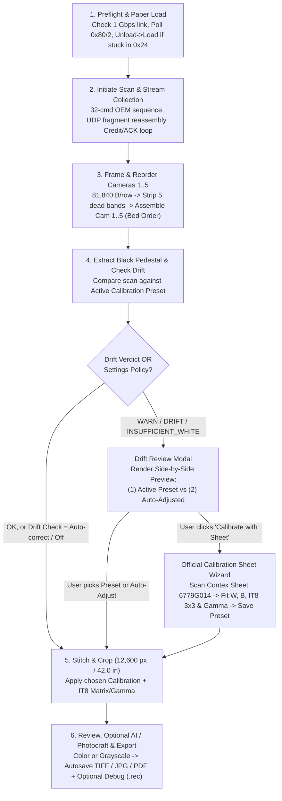

# Contex HD Ultra i4250s — Modern Scanner App Architecture & Implementation Plan

This document defines the architecture and phased build for the Ubuntu scanner application (with a clean path to a standalone Windows/Linux desktop build in Stage 2), integrating everything proven in [`SPECS.md`](../SPECS.md), [`DESIGN.md`](../DESIGN.md), [`analysis/color/COLOR-REPORT.md`](../engineering/analysis/color/COLOR-REPORT.md), and [`analysis/stitch/STITCH-REPORT.md`](../engineering/analysis/stitch/STITCH-REPORT.md).

---

## 1. Technology Stack & 2-Stage Portability Strategy

> [!TIP]
> **Why an i9-9900 + RTX 4080 + 32 GB RAM workstation is ideal:**
> - **32 GB System RAM** easily holds a full 42" × 36" 16-bit 5-camera scan in memory (~750 MB raw `.rec` + ~750 MB stitched `uint16` array) with room to spare.
> - **NVIDIA RTX 4080 (16 GB VRAM)** is more than powerful enough for sub-second 16-bit color/stitch math AND local tiled AI restoration (denoising, background cleanup, seam healing), while also supporting external MCP tools like Photocraft.

* **Stage 1 (MVP — Fast Iteration on Ubuntu)**:
  * **Backend**: **Python 3.12 + FastAPI + WebSockets** (`ctx/server.py`, running on top of our `numpy`, `Pillow`, and `socket` codebase in [`ctx/`](../ctx/)).
  * **Frontend**: **Modern Dark-Mode Studio Web UI** (`ctx/web/`) — three columns: a left control sidebar (Scan Setup / AI & Enhance), a centre viewer (engine status strip with an animated activity beam, render-view tabs, HTML5 deep-zoom canvas for 100+ MP scans) and a right action rail (scanner status, feed controls, Initiate Scan, Output & Autosave, Calibration Sheet Wizard). It includes an interactive A/B split-slider, a Thermal Drift Comparison Modal with one shared zoom/pan view for both previews, and the Official Contex Calibration Sheet Wizard with automatic IT8 grid alignment.
  * **MCP Interface**: Built-in **FastMCP Server** (`ctx/mcp_server.py`) so external AI clients (Claude, Antigravity, Photocraft, etc.) can invoke scanner tools and post-process images.
* **Stage 2 (Standalone Linux & Windows App)**:
  * Wrap the Web UI in **Tauri** or **PyWebView** and bundle the Python backend with **PyInstaller**. Because our network protocol is pure TCP/UDP sockets (`58169`/`58170`/`58171`), the exact same codebase runs natively on both **Ubuntu** and **Windows** without needing Contex's `.NET` / `CtxScan64.dll` stack.

---

## 2. End-to-End Application Workflow

---

## 3. Core Architecture & Modules

### Module 1: Unified Hardware & Transport Engine (`ctx/engine.py`)
Upgrades [`ctx/session.py`](../ctx/session.py) with the proven live logic from `tools/cap/replay_vendor.py` (private development tree):
* **Network Preflight**: Checks Ethernet interface link speed (`/sys/class/net/*/speed` on Linux) and warns if `< 1000` Mbps; allocates a `64 MB` UDP receive buffer (`SO_RCVBUF`).
* **Paper Control & Auto-Recovery**:
  * Status polling (`READ 0x80/2`) with human-readable state (`No Media`, `Inserted`, `Busy Loading`, `Ready 0x30`, `Scanning 0x24`, `Ejected 0x10`).
  * Automatic `Unload (0x31, fn=0)` → `Load (0x31, fn=1)` recovery when the scanner is left in `0x24 SCANNING`.
  * Post-scan paper handling configurable in UI: **Hold in Rollers**, **Eject Back (`0xFFFFFF`)**, or **Eject Front (`0xFFFFFE`)**.
* **Hard Flash Guard**: Blocks `WRITE BUFFER 0xA0` and programming modes unconditionally (`DESIGN.md` §1).

### Module 2: Camera-First Calibration, Multi-Preset Store & Drift Engine (`ctx/calibration.py`)
Unifies `analysis/stitch/stitch16.py`, `analysis/stitch/colourcal.py`, and `tools/colour_drift.py` (private development tree):
1. **Camera Reordering (`cam1..cam5`)**:
   * Locates the five 23-px zero bands (`490 + 2728*k`) and masked ramps via `module_gaps()`, reassembling `cam1..cam5` (`cam5 = piece5 + piece0`) *before* any color or drift evaluation.
2. **Calibration Preset Manager (`~/.config/contex/<serial>/presets/`)**:
   * Supports **multiple named presets** (`Official Contex IT8 + Flat-Field`, `3D Architectural & CAD Bond`, `Fine Art & Large Photo`, plus user-saved presets).
   * Each preset stores:
     * Per-camera spatial white profile `W_i(col, ch)` and optical black pedestal `B_i(ch)`
     * Colorimetric transform: `gamma`, 3×3 `matrix`, and `offset`
     * Provenance metadata and automatic `.bak` rollback history.
3. **Drift Analyzer + Dual-Render Preview**:
   * Evaluates camera-to-camera chroma spread and white-level deviation on `cam1..cam5`.
   * The **Colour / Temp Drift Check** selector in **Scan Setup** has three states: `Ask before applying` (default), `Auto-correct silently`, and `Off — bulk, fastest`. `Off` skips both the drift analysis and the auto-adjusted second stitch — the bulk-scanning path, worth ~29 s per 42" / 300 dpi sheet.
   * When drift is detected, generates **two preview renders** from the in-memory scan:
     * **Render A (Default Preset)**: Using the stored preset without per-scan polynomial gain adjustment.
     * **Render B (Auto-Adjusted)**: Using white-sheet shape `W` × smooth degree-5 polynomial gain `s(col)` fitted to the scan's margins, plus live optical black `B`.
   * For **full-bleed artwork/photos**: When `INSUFFICIENT_WHITE` is returned (no white margins on the artwork), the UI informs the user that margin auto-adjust is unavailable and recommends using the **Active Preset** or running the **Calibration Sheet Wizard**.
4. **Official Calibration Sheet Wizard**:
   * Guided UI wizard for scanning the **Contex Official Calibration Sheet (`p/n 6779G014`, Charge `R170829`)**:
     * **Mode 1: Full-Width White Flat-Field** → updates `W_i(col, ch)` and `B_i(ch)`.
     * **Mode 2: Full IT8.7/2 Colorimetric Calibration (`R170829.it8`)** → locates the 264 patches + 24 grey steps + white/black bands, fits `gamma`, 3×3 `matrix`, and `offset`, reports achieved ΔE76, and saves as a new or updated preset.
     * **IT8 auto-align** (`auto_align=True`, the default): the nominal `SHEET_MOSAIC` window is only a starting guess — a hand-placed sheet lands a few tenths of an inch off — so the wizard sweeps the 22×12 sampling window, keeps the offset with the lowest mean ΔE76, reports it in 300-dpi pixels, and refuses to apply a fit above `ΔE76 = 8.0`. The report also names the reference table used and warns when only the approximate `ctx/data/colour-patches.csv` fallback is available.

### Module 3: 16-Bit Stitcher, Export & Autosave Engine (`ctx/pipeline.py`)
* **Color Modes**:
  * **Color**: 16-bit or 8-bit sRGB with DPI tags.
  * **Grayscale**: Rec. 709 luminance-weighted 16-bit or 8-bit grayscale conversion.
* **Formats**:
  * **TIFF**: 8-bit LZW or 16-bit with `300 DPI` resolution tags so 3D architectural drawings retain 1:1 physical scale.
  * **JPEG**: 8-bit sRGB with configurable quality (default `95`) and DPI metadata.
  * **PDF**: Architectural/archival PDF with exact physical page dimensions (`42.00 in × H in`).
* **Render variants & filenames**:
  * A scan produces up to three renders — `preset`, `auto_adjust`, `ai_enhanced` — and all of them share the scan's number (`scan_0087`, `scan_0087_Auto`, `scan_0087_AI`). The number is reserved for all three variants at scan time, and saving the same view twice moves the whole group to the next number, so nothing is overwritten.
  * **Autosave scope**: autosave writes the job's standard calibrated render (stored preset, or the accepted auto-adjusted one) and never an AI render on its own; with **Auto AI Enhance** enabled it also writes the matching `_AI` file. Each render is written once, so a later AI run cannot duplicate the standard file.
  * **Memory retention**: only the two newest scans keep their raster and stitched buffers (re-export and sheet calibration stay available); older jobs release them and keep metadata, previews and exported files — a long bulk run stays near ~3.2 GiB instead of ~1.6 GiB per sheet.
* **Debug Toggle**:
  * When enabled in Settings, automatically saves `<scan_id>.rec` (raw UDP records), `<scan_id>.jsonl` (SCSI command transcript), 1:1 seam crops around the four composite joins `x = 2586, 5108, 7642, 10168`, and `<scan_id>-diagnostics.json` into `scans_output/debug/`.

### Module 4: MCP Server & Generative AI / Photocraft Integration (`ctx/mcp_server.py` & `ctx/ai.py`)
* **Exposed MCP Tools**:
  * `scanner_status()` — connection, media state, link speed, active preset.
  * `scanner_paper_control(action="load" | "unload" | "eject_front" | "eject_back" | "recover")`
  * `scanner_initiate_scan(source_mode, rec_path, width_inches, color_mode, preset_id, simulate_thermal_drift)`
  * `scanner_resolve_drift(scan_id, choice="preset" | "auto_adjust", promote_to_preset, save_as_new_preset_name)`
  * `scanner_cancel_scan()`
  * `scanner_calibrate_official_sheet(scan_id, sheet_mode="white_flatfield" | "it8_full", save_as_preset_id, save_as_preset_name, auto_align=True)`
  * `scanner_ai_enhance(scan_id, blend_seam_colors, seam_blend_width_px, seam_blend_strength, seam_feather_mode, heal_seams, seam_radius_px, clean_background, denoise_shadows, sharpen_detail, external_provider, external_url, external_prompt)`
  * `scanner_export(scan_id, formats, color_mode, tiff_16bit, debug_mode, render_mode="preset" | "auto_adjust" | "ai_enhanced")`
* **Post-Processing Bridge**:
  * **Local Restoration Filters**: 4-Seam Micro-Inpainting, 3D Architectural Background Cleanup, Camera 4/5 Shadow & Chroma Denoising, and Edge-Aware Detail Sharpening.
  * **External MCP / Photocraft Webhook**: Sends the stitched scan to an external HTTP/Photocraft endpoint and imports the enhanced image for A/B review.

